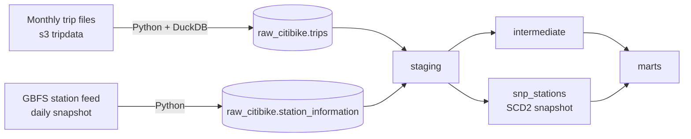

# Citi Bike Analytics Engineering

End-to-end analytics engineering project on public NYC Citi Bike data: ingestion with
Python and DuckDB, modeling in dbt on BigQuery, SCD Type 2 station history, orchestration
with Airflow, and CI on every pull request.

The project covers 13 months of trips (Sep 2025 – Sep 2026, ~50.7M trips, ~2.6k stations)
and is built to answer operational questions such as *which stations lose bikes and need
rebalancing* and *how demand changes by season, hour and rider type*.

## Architecture



| Layer | Tools |
|---|---|
| Ingestion | Python, DuckDB (CSV to Parquet), BigQuery load jobs |
| Warehouse | BigQuery (EU) |
| Transformation | dbt Core 1.12, dbt_utils |
| Orchestration | Airflow 3 (Astro CLI), Astronomer Cosmos |
| Quality | dbt data tests, unit tests, model contracts, SQLFluff |
| CI | GitHub Actions (Slim CI) |

## Data model

| Model | Layer | Materialization | Grain |
|---|---|---|---|
| `stg_citibike__trips` | staging | view | trip (as delivered, may contain duplicates) |
| `stg_citibike__station_information` | staging | view | station × snapshot date |
| `int_trips__deduplicated` | intermediate | incremental, `insert_overwrite` | trip |
| `int_trips__enriched` | intermediate | view | trip |
| `int_stations__current` | intermediate | view | station (latest snapshot) |
| `int_stations__from_trips` | intermediate | table | station seen in trips |
| `snp_stations` | snapshot | SCD2, `check` strategy | station version |
| **`fct_trips`** | mart | incremental, `insert_overwrite` | trip |
| **`fct_station_daily`** | mart | table | station × local day |
| **`dim_stations`** | mart | table | station (current state) |
| **`dim_stations_history`** | mart | table | station version (SCD2) |
| **`dim_date`** | mart | table | calendar day |

Marts are the public layer: all five have enforced model contracts.

## Key decisions

**Partitioning by source batch, not by trip date.** Raw and incremental tables are
partitioned by `_batch_month` (the month of the source file). A trip that starts in one
month and ends in the next appears in the file of the end month, so partitioning by trip
date would split one file across two partitions and make `insert_overwrite` unsafe.
With batch partitions, every load replaces whole partitions and is idempotent.

**`insert_overwrite` instead of `merge`.** A `merge` on the deduplicated trips table
scanned the whole table on every run. `insert_overwrite` rewrites only the latest
partitions: an incremental run of `fct_trips` processes ~1.3 GiB instead of ~6.2 GiB for a
full rebuild.

**"Latest file wins" deduplication.** Each run reprocesses the last stored batch together
with the new one, so duplicates between neighbouring files are resolved in favour of the
most recent file.

**SCD Type 2 for stations.** Station names, capacity and coordinates change over time.
A daily GBFS snapshot feeds a dbt snapshot (`check` strategy: the feed's `last_updated`
changes every minute, so the `timestamp` strategy would create a new version every day).
History before the first snapshot is unknown, so the first known version of each station
is treated as valid from 1900-01-01. Stations that closed before snapshots started are
added from trip data.

**Two station dimensions.** `dim_stations` holds the current state for most analysis;
`dim_stations_history` is used for point-in-time joins
(`started_at >= valid_from and started_at < valid_to`).

## Source data issues found and handled

| Issue | Impact | Handling |
|---|---|---|
| Timestamps are New York local time stored as if they were UTC | All durations and hours shifted | Converted in staging with `timestamp(datetime(col), 'America/New_York')` |
| Repeated hour at the end of DST (2025-11-02) | 482 trips with negative duration | Trips with a negative gap under one hour get `ended_at` shifted by one hour and `is_dst_adjusted = true`; larger gaps are left as real data errors. Covered by a unit test |
| Station ids lose a trailing zero (`5785.1` instead of `5785.10`) | ~0.6% of station events per month | Zero added only when the two-decimal id exists in the data; three stations with genuinely short ids confirmed via GBFS. Covered by a singular test |
| April 2026 file cut by start date instead of end date | 512 trips duplicated with May; trips from 2026-03-31 to 2026-04-01 missing in the source | Duplicates removed by deduplication; the gap is documented as a source limitation |
| Station capacity 0 | 45 stations | Confirmed against the GBFS status feed: these stations are removed; some removed stations keep their old capacity |

## Data quality

| Check | What it covers |
|---|---|
| Unit tests | DST adjustment logic; trip flags (duration, round trip without end station, trips over 24h) |
| Model contracts | Column names and types of all marts; `not_null` constraints on keys enforced by BigQuery |
| Data tests | Uniqueness, not-null, accepted values, relationships, SCD2 ranges do not overlap (`mutually_exclusive_ranges`) |
| Custom generic test | `null_proportion`: share of nulls per source batch stays under a threshold set from observed data (one bad month cannot hide among good ones) |
| Source freshness | Trips: warn after 45 days, error after 75; stations: warn after 2 days, error after 4 |

## Orchestration

Two Airflow DAGs; every dbt model runs as its own task through Cosmos, with its tests
right after it.

- **`citibike_stations_daily`** (06:00 UTC): load today's GBFS snapshot → dbt snapshot →
  station models.
- **`citibike_trips`** (07:00 UTC): find the next month to load from what is already in
  BigQuery → check whether the file is published → if yes, load it and build the whole
  project; if not, skip and check again tomorrow. Missed months are caught up
  automatically, one per run.

All loads are idempotent: rerunning a task replaces the same partition.

## Environments and CI

| Environment | Dataset | Built by |
|---|---|---|
| dev | `dbt_dev` | developer, locally |
| ci | `dbt_ci_pr_<number>` (dropped after each run) | GitHub Actions |
| prod | `dbt_prod` | Airflow, from `main` only |

Every pull request to `main` runs SQLFluff and **Slim CI**: `dbt build --select
state:modified+ --defer`, comparing against a manifest of `main`, so only changed models
and their children are built and everything else is read from production. `main` is
protected: changes land only through pull requests with a green CI check.

Airflow, CI and the developer use separate service accounts with only the BigQuery Data
Editor and Job User roles.

## Limitations

- Airflow runs locally with the Astro CLI, so scheduled runs happen only while the laptop
  is on. In production it would run on a managed service (Cloud Composer or Astro); the
  DAGs would not change.
- Station history starts at the first GBFS snapshot; earlier attribute changes are not known.
- Trips within the repeated DST hour that do not produce a negative duration cannot be
  detected and may be off by up to one hour.

## Repository structure

```
citibike_dbt/        dbt project (models, snapshots, tests, macros)
airflow/             Astro project: DAGs, Python loaders, dbt profile for prod
scripts/             original bash loaders used before Airflow
.github/             CI workflow and dbt profile for CI
```

## Running locally

Requirements: Python 3.12, a Google Cloud project with BigQuery, Docker and the Astro CLI.

```bash
python -m venv .venv
source .venv/bin/activate
pip install -r requirements.txt

cd citibike_dbt
dbt deps
dbt build
```

Airflow:

```bash
cd airflow
astro dev start
```

Before starting Airflow, set the paths in `airflow/docker-compose.override.yml` and place a
service account key at the location referenced in `airflow/.env`.